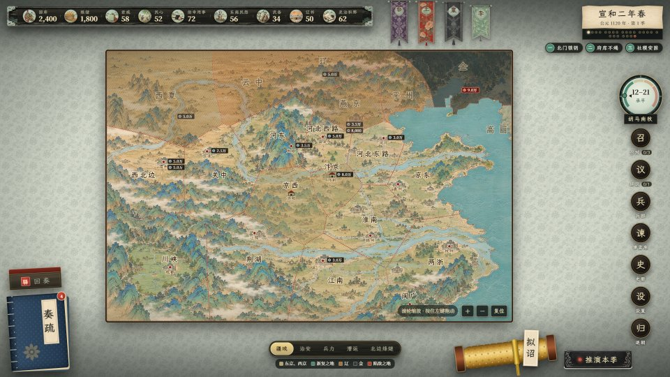
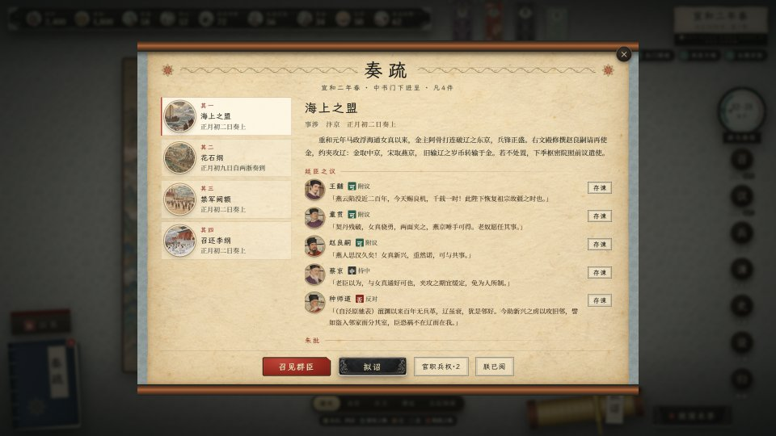
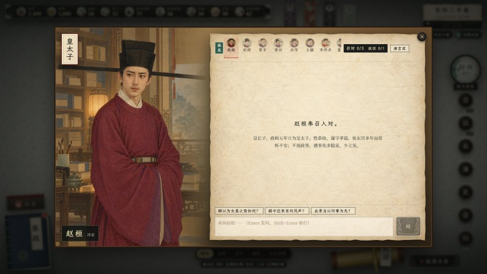
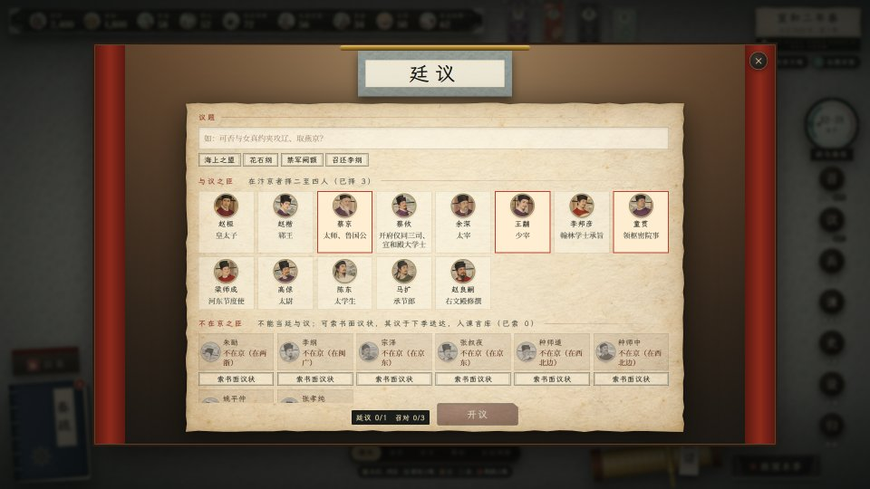
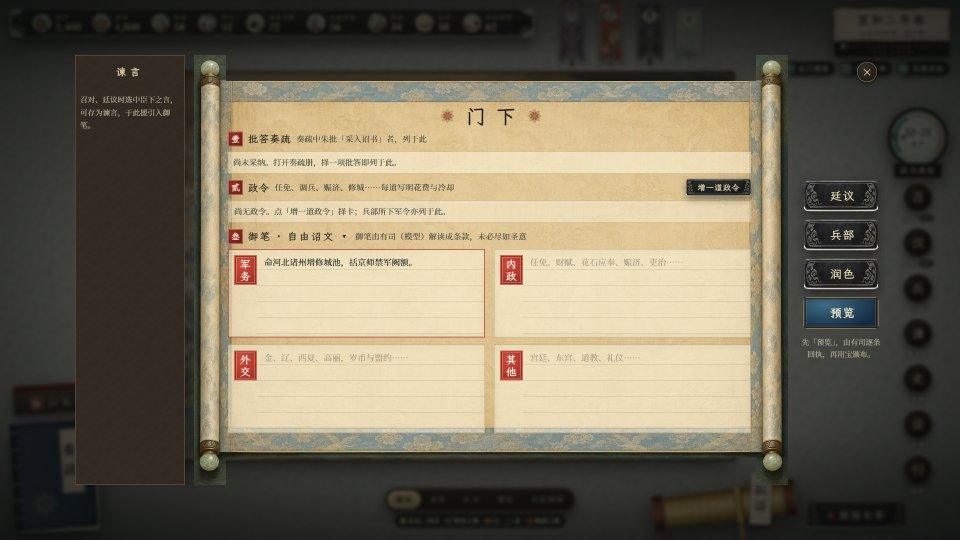
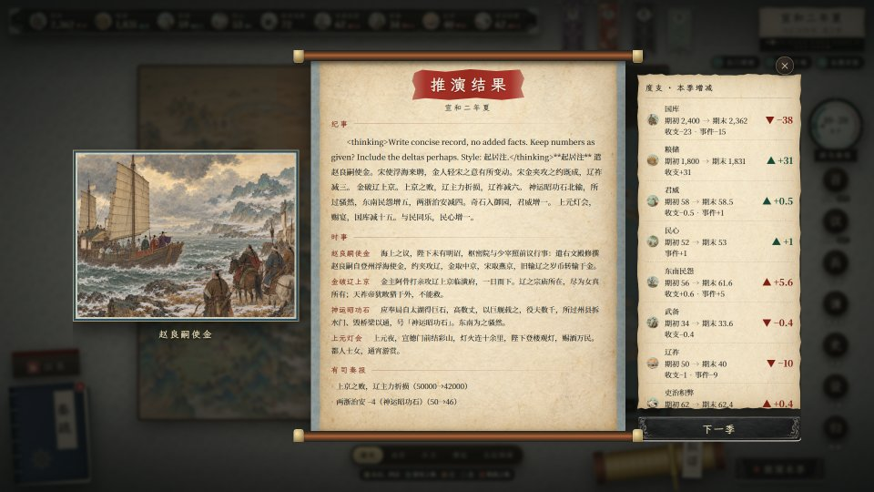
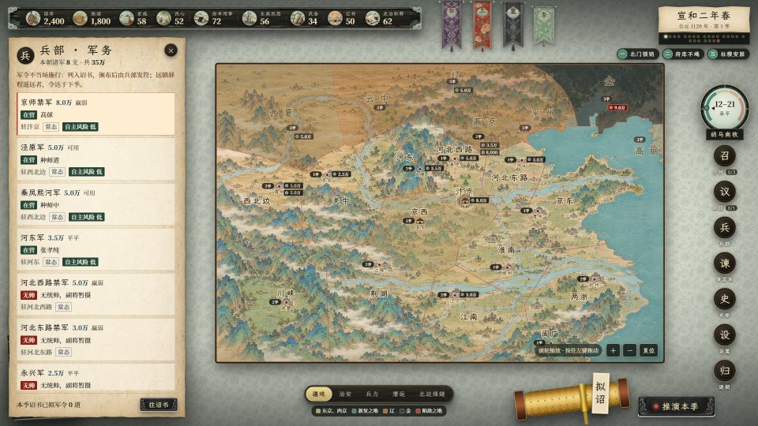
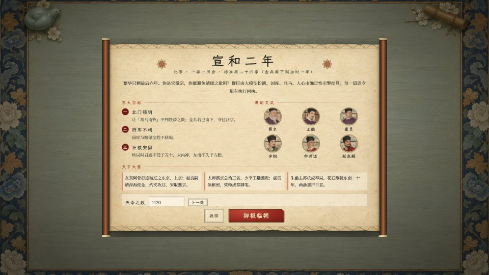

<p align="center">
  
</p>

<h1 align="center">宣和</h1>

<p align="center">
  <b>繁华只剩最后六年。你能避免靖康之耻吗？</b><br>
  一款 AI 驱动的历史模拟：你是宣和二年（公元 1120 年）的宋徽宗，满朝文武由大模型扮演。
</p>

<p align="center">
  <a href="LICENSE"></a>
  
  
  
</p>

<p align="center">
  <!--DOWNLOAD-->
</p>

---

## 这是什么游戏

辽已残破，女真新兴；海上之盟正在议定，花石纲扰东南已二十年。你是宋徽宗赵佶——书画天下第一，治国却常被身边人蒙蔽。
二十四季之后，史书上写着「靖康」：金兵两路南下，汴京城破，二帝北狩。

你能改写它吗？

- **四条主线交织**：外交（联金灭辽，还是坐观、存辽；燕京是打下来、买回来，还是不要）、内政（花石纲、方腊、宋江、免夫钱）、朝局（蔡京、王黼、童贯、梁师成、朱勔与李纲、宗泽、张叔夜；东宫与郓王）、军务（禁军阙额、西军、河北边备、太原与汴京城防）。
- **一个看不清的危机**：顶上的「胡马南牧」是金人南侵之势，它由金势日张、金人轻宋、武备、佞幸、君威等几项推动——而「金人轻宋」只能看到风闻区间。伐燕不克、赎回空城、纳叛而又杀之、许粮不输，都会让金人看轻你。
- **辽是一块会融化的屏障**：「辽祚」逐季消退；辽亡之后，宋与金直接为邻。
- **十四种结局**：燕云在握、保境安民、却敌河上、唇齿相依、城下之盟、划河而守、衣冠南渡、内禅东宫、佞幸专国、靖康之耻……以及帑竭兵变、东南板荡、群盗蜂起三种速败。每个结局都写明【达成条件】。
- **AI 只扮演，不篡改**：召对、廷议时大臣由大模型扮演，但国库、兵马、人心都由确定性引擎结算；每一道诏令都有逐条执行回执（可行 / 驳回 / 稽迟），数字只来自引擎。

## 游戏画面

<table>
  <tr>
    <td><br><sub>御案：顶上是国势与危机计「胡马南牧」，中间是舆图（疆域、治安、兵力、漕运、北边烽燧五层）</sub></td>
    <td><br><sub>奏疏：每道写明奏到日期、谏言与各选项的确切代价</sub></td>
  </tr>
  <tr>
    <td><br><sub>召对：大臣由大模型按人设与引擎事实扮演，数字只来自引擎</sub></td>
    <td><br><sub>廷议：在京者当廷与议，不在京者递书面议状</sub></td>
  </tr>
  <tr>
    <td><br><sub>拟诏：采纳奏疏、使用政令卡，或以御笔自由书写；有司逐条回执</sub></td>
    <td><br><sub>推演结果：纪事、时事、有司奏报与逐项对账</sub></td>
  </tr>
  <tr>
    <td><br><sub>兵部：诸军兵力、统帅、行程、军令与将领自主风险</sub></td>
    <td><br><sub>新局：三档难度（演义、史实、地狱）</sub></td>
  </tr>
</table>

## 怎么玩

### 桌面版（Windows，推荐）

<!--INSTALL-->

### 在 Codex / Claude Code 里玩

游戏自带 MCP 服务（`xuanhe`），你的 Claude Code 或 Codex 可以直接「上朝」：读简报、召对、廷议、下诏、结算，与桌面版共用存档。

```powershell
# 桌面版已安装时：把安装目录里的引擎注册给本机的 Claude Code 和 Codex
powershell -ExecutionPolicy Bypass -File integrations/setup_mcp.ps1
```

然后对它说：「开一局宣和，先看简报」。详见 [integrations/README.md](integrations/README.md)。

### 网页版（从源码运行）

需要 Python 3.11+、Node.js 22+。

```bash
git clone --recurse-submodules https://github.com/Yi-111-a/xuanhe.git
cd xuanhe
python -m venv .venv && .venv/Scripts/pip install -e "engine/backend[dev]"
.venv/Scripts/python scripts/dev_backend.py --port 8765      # 引擎
npm --prefix app ci && npm --prefix app run dev               # 另一个终端：界面 http://127.0.0.1:5173
```

没有任何模型也能从头玩到尾（离线时大臣按人设与事实说话）。要真实的大臣，在「设置 → 模型」里选「Claude（本机）」或「Codex（本机）」——用你本机已登录的命令行，不需要 API key；也可以接任意 OpenAI 兼容服务。

## 它是怎么做的

- 引擎：[llm-sim-game-template](https://github.com/Yi-111-a/llm-sim-game-template)（`engine/` 子模块）。剧本是纯数据包 [`scenarios/xuanhe_1120/`](scenarios/xuanhe_1120)：31 位人物、21 个地区、154 个事件、181 道奏疏、29 张政令卡、14 种结局、三档难度。
- 设计与史实：[设计大纲](docs/XUANHE_OUTLINE.md)、[史实核对](docs/FACT_CHECK.md)（逐卷核对《宋史》《金史》《辽史》《宋史纪事本末》）、[迭代日志](docs/ITERATION_LOG.md)。
- 美术：全部由 Codex 按北宋院体工笔与青绿山水的风格块生成，逐张人工验收（[验收记录](design/asset_prompts/QA.md)），图中不含任何文字。
- 测试：引擎单元测试、两套内容检查（模板通用 + 本剧本 14 项）、每档难度 300 种子的平衡模拟（史实档稳健打法约四分之三得好结局、放任约九成靖康）、Playwright 界面测试（每个按钮、从开局打到结局），以及 GPT（Codex）、Claude 与开发者本人经 MCP 的整局试玩。

## 文档

| 文档 | 内容 |
|---|---|
| [GAME_PLAN.md](docs/GAME_PLAN.md) | 开发计划与验收门槛 |
| [XUANHE_OUTLINE.md](docs/XUANHE_OUTLINE.md) | 剧本大纲：资源、危机计、主线、人物、地图、结局、旗标 |
| [FACT_CHECK.md](docs/FACT_CHECK.md) | 史实核对与本游戏设定 |
| [ITERATION_LOG.md](docs/ITERATION_LOG.md) | 每轮试玩的问题与修复 |
| [integrations/](integrations/README.md) | Claude Code 插件与 Codex 接入 |

## 许可

代码 MIT（见 [LICENSE](LICENSE)）。美术为本项目用 Codex 生成的原创作品，随仓库以同一许可提供。史实部分只作游戏设定，不作史学结论。
